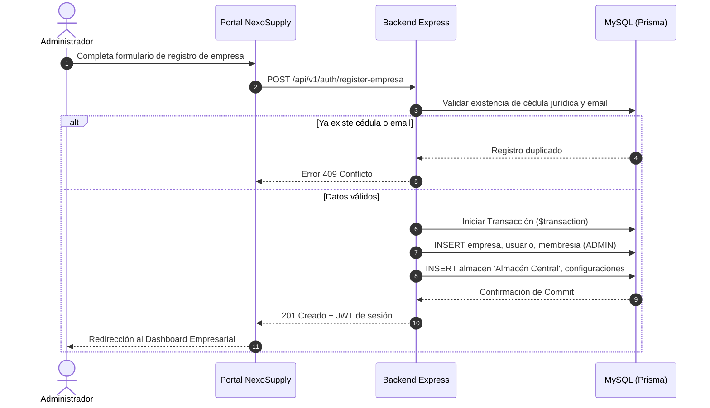
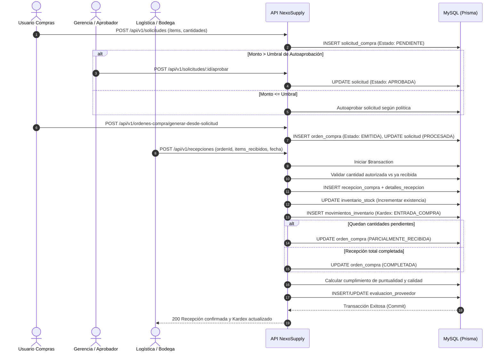

# 04. Modelo de Procesos de Negocio — NexoSupply CR

Este documento define los 16 procesos empresariales clave mediante especificaciones operativas y diagramas Mermaid.

---

## Proceso 1: Registro e Incorporación de una Empresa
- **Actor Responsable**: Administrador de la Plataforma / Usuario Solicitante.
- **Entrada**: Razón Social, Cédula Jurídica, Nombre Comercial, Email del Administrador Principal, Contraseña.
- **Validaciones**: Unicidad de Cédula Jurídica en el sistema, formato de correo válido, contraseña con política de complejidad.
- **Resultado**: Creación de la empresa, creación del usuario principal, creación de la membresía con rol `ADMINISTRADOR_EMPRESARIAL`, creación del almacén principal por defecto y parámetros iniciales.



---

## Proceso 2: Selección y Conmutación Segura de Empresa (Switch Tenant)
- **Actor Responsable**: Usuario autenticado con membresías múltiples.
- **Entrada**: `empresaId` destino seleccionado en la barra de navegación.
- **Validaciones**: Verificación de membresía activa en la base de datos MySQL, validación de estado de la empresa destino.
- **Resultado**: Emisión de nuevo token de sesión con claims de la empresa destino, actualización de contexto y recarga de vistas.

```mermaid
flowchart TD
    A([Usuario en Frontend]) --> B[Selecciona Empresa B en Selector]
    B --> C[POST /api/v1/auth/switch-tenant { empresaId }]
    C --> D{¿Sesión activa?}
    D -- No --> E[401 No Autorizado -> Login]
    D -- Sí --> F{¿Membresía activa en Empresa B?}
    F -- No --> G[403 Acceso Denegado]
    F -- Sí --> H{¿Empresa B está activa?}
    H -- No --> I[403 Empresa Suspendida/Inactiva]
    H -- Sí --> J[Consultar Roles y Permisos en Empresa B]
    J --> K[Generar nuevo JWT de Contexto + Cookie]
    K --> L[200 OK + Retornar Perfil y Permisos]
    L --> M[Frontend: Invalida Caché y Carga Dashboard de Empresa B]
```

---

## Proceso 3: Ciclo Completo de Abastecimiento (Solicitud -> Aprobación -> Orden -> Recepción -> Kardex)



---

## Proceso 4: Evaluación Objetiva de Proveedores
- **Actor Responsable**: Sistema automatizado / Gestor de Compras.
- **Entrada**: Datos acumulados de órdenes recibidas en el período (fechas prometidas vs reales, cantidades solicitadas vs recibidas, incidencias registradas).
- **Fórmulas de Negocio**:
  - $ICP = \frac{\text{Órdenes a Tiempo}}{\text{Total Órdenes}} \times 100$
  - $ICC = \frac{\text{Unidades Conformes Recibidas}}{\text{Total Unidades Solicitadas}} \times 100$
  - $IINC = 100 - (\text{Ponderación de Incidencias Totales})$
  - $Score = (ICP \times 0.40) + (ICC \times 0.35) + (IINC \times 0.25)$

---

## Proceso 5: Simulación de Continuidad Operativa (What-If Analysis)
- **Actor**: Gerente de Logística / Administrador.
- **Entrada**: ID del Proveedor Crítico, Días de retraso proyectados (ej. 15 días).
- **Mecanismo**: El motor consulta las órdenes vigentes con dicho proveedor y el inventario actual de los productos que suministra. Modela el agotamiento proyectado de stock según el consumo diario promedio y detecta la fecha exacta de "Quiebre de Stock". Identifica proveedores alternativos dados de alta y calcula el sobrecosto de reposición emergente.
- **Regla Estricta**: **Cero escrituras en tablas operativas**. Las simulaciones se guardan exclusivamente en la tabla `simulaciones_continuidad` como registros analíticos.
