# 05. Modelo Entidad-Relación — NexoSupply CR

El diseño de datos de NexoSupply CR para MySQL 8 (InnoDB, `utf8mb4_unicode_ci`) implementa integridad referencial completa mediante Prisma ORM, tipos numéricos decimales para cálculo monetario exacto (`DECIMAL(12,2)` / `DECIMAL(12,4)`), claves primarias UUID para prevención de ataques de enumeración e IDOR, y discriminadores multiempresa indexados.

---

## 1. Diagrama Entidad-Relación Físico (Prisma / MySQL 8)

```mermaid
erDiagram
    empresas ||--o{ membresias_empresa : posee
    empresas ||--o| configuraciones_empresa : parametriza
    empresas ||--o{ roles : define
    empresas ||--o{ invitaciones_empresa : emite
    empresas ||--o{ almacenes : opera
    empresas ||--o{ categorias : clasifica
    empresas ||--o{ unidades_medida : utiliza
    empresas ||--o{ productos : cataloga
    empresas ||--o{ proveedores : gestiona
    empresas ||--o{ productos_proveedores : vincula
    empresas ||--o{ solicitudes_compra : emite
    empresas ||--o{ ordenes_compra : autoriza
    empresas ||--o{ recepciones_compra : recibe
    empresas ||--o{ inventario_stock : custodia
    empresas ||--o{ movimientos_inventario : audita_kardex
    empresas ||--o{ evaluaciones_proveedor : califica
    empresas ||--o{ incidencias_proveedor : registra
    empresas ||--o{ historial_precios : rastrea
    empresas ||--o{ alertas_riesgo : alerta
    empresas ||--o{ simulaciones_continuidad : proyecta
    empresas ||--o{ documentos_empresa : almacena
    empresas ||--o{ consultas_chatbot_log : registra

    usuarios ||--o{ membresias_empresa : asigna
    usuarios ||--o{ solicitudes_compra : solicita
    usuarios ||--o{ aprobaciones_solicitud : aprueba
    usuarios ||--o{ ordenes_compra : crea
    usuarios ||--o{ recepciones_compra : recepciona
    usuarios ||--o{ movimientos_inventario : autoriza
    usuarios ||--o{ simulaciones_continuidad : modela
    usuarios ||--o{ registros_auditoria : ejecuta

    roles ||--o{ membresias_empresa : otorga
    roles ||--o{ roles_permisos : agrupa
    permisos ||--o{ roles_permisos : concede

    proveedores ||--o{ contactos_proveedores : tiene
    proveedores ||--o{ productos_proveedores : cotiza
    proveedores ||--o{ ordenes_compra : suministra
    proveedores ||--o{ evaluaciones_proveedor : evaluado_en
    proveedores ||--o{ incidencias_proveedor : reportado_en
    proveedores ||--o{ historial_precios : cotiza_historico

    categorias ||--o{ productos : agrupa
    unidades_medida ||--o{ productos : mide

    productos ||--o{ productos_proveedores : ofrecido_por
    productos ||--o{ detalles_solicitud : solicitado_en
    productos ||--o{ detalles_orden : comprado_en
    productos ||--o{ detalles_recepcion : entregado_en
    productos ||--o{ inventario_stock : ubicado_en
    productos ||--o{ movimientos_inventario : movilizado_en
    productos ||--o{ historial_precios : registra_costo

    solicitudes_compra ||--|{ detalles_solicitud : detalla
    solicitudes_compra ||--o{ aprobaciones_solicitud : revisa
    solicitudes_compra ||--o| ordenes_compra : genera

    ordenes_compra ||--|{ detalles_orden : desglosa
    ordenes_compra ||--o{ recepciones_compra : abastece
    ordenes_compra ||--o{ incidencias_proveedor : causa

    recepciones_compra ||--|{ detalles_recepcion : verifica
    detalles_orden ||--o{ detalles_recepcion : cruza_cantidades

    almacenes ||--o{ inventario_stock : guarda
    almacenes ||--o{ movimientos_inventario : traza
    almacenes ||--o{ ordenes_compra : destino_de
    almacenes ||--o{ recepciones_compra : ingresa_en
```

---

## 2. Inventario de Tablas Creadas en MySQL 8

A continuación se listan las 32 tablas creadas bajo el motor InnoDB en `nexosupply_cr`:

1. `_prisma_migrations`: Registro interno de migraciones aplicadas.
2. `empresas`: Entidad principal de inquilinos (Tenants).
3. `usuarios`: Identidades de usuario centralizadas.
4. `membresias_empresa`: Vinculación usuario-empresa con asignación de rol (`uk_usuario_empresa`).
5. `roles`: Roles del sistema o personalizados por empresa (`uk_rol_empresa_codigo`).
6. `permisos`: Catálogo atómico de permisos del sistema.
7. `roles_permisos`: Asociación N:M entre roles y permisos.
8. `invitaciones_empresa`: Tokens seguros de invitación de usuarios a empresas.
9. `configuraciones_empresa`: Políticas de autoaprobación y tolerancias por empresa.
10. `almacenes`: Almacenes físicos de almacenamiento (`uk_almacen_empresa_codigo`).
11. `categorias`: Categorías de catálogo (`uk_categoria_empresa_codigo`).
12. `unidades_medida`: Unidades de medida estándar (`uk_unidad_empresa_codigo`).
13. `proveedores`: Directorio y condiciones comerciales de proveedores (`uk_proveedor_empresa_fiscal`).
14. `contactos_proveedores`: Personas de contacto clave por proveedor.
15. `productos`: Maestro de ítems e inventario (`uk_producto_empresa_sku`).
16. `productos_proveedores`: Catálogo de abastecimiento cruzado (`uk_producto_proveedor`).
17. `solicitudes_compra`: Requerimientos de compra de departamentos.
18. `detalles_solicitud`: Líneas de ítems solicitados con cantidades y precios estimados.
19. `aprobaciones_solicitud`: Registro formal de aprobación/rechazo de solicitudes.
20. `ordenes_compra`: Órdenes contractuales de compra a proveedores (`uk_orden_empresa_numero`).
21. `detalles_orden`: Ítems autorizados, cantidades pendientes y recibidas.
22. `recepciones_compra`: Actas de entrega física en bodega (`uk_recepcion_empresa_numero`).
23. `detalles_recepcion`: Verificación física ítem por ítem con detección de rechazos.
24. `inventario_stock`: Existencias consolidadas por almacén y producto (`uk_inventario_empresa_alm_prod`).
25. `movimientos_inventario`: Kardex inmutable para trazabilidad de cada unidad física.
26. `evaluaciones_proveedor`: Evaluaciones mensuales y trimestrales con índices matemáticos (`uk_evaluacion_empresa_prov_periodo`).
27. `incidencias_proveedor`: Histórico de anomalías, faltantes y retrasos de proveedores.
28. `historial_precios`: Auditoría inmutable de variaciones de costos de compra.
29. `alertas_riesgo`: Sistema de alertas automáticas (stock mínimo, retrasos, etc.).
30. `simulaciones_continuidad`: Sandbox analítico para proyecciones de contingencia.
31. `registros_auditoria`: Registro de trazabilidad y gobernanza de operaciones.
32. `documentos_empresa` y `consultas_chatbot_log`: Capa desacoplada para gestión documental y logs del asistente.

---

## 3. Restricciones y Reglas Físicas de Aislamiento

1. **Claves Foráneas con Eliminación Restringida (`ON DELETE RESTRICT`)**:
   - `proveedores -> empresas`: Impide la eliminación accidental de un inquilino si tiene proveedores registrados.
   - `productos -> empresas`: Protege el catálogo.
   - `ordenes_compra -> proveedores`: Impide eliminar un proveedor con órdenes históricas.
   - `movimientos_inventario -> productos / almacenes`: Garantiza la inmutabilidad del Kardex.
2. **Cascada Controlada (`ON DELETE CASCADE`)**:
   - Limitada exclusivamente a componentes dependientes de un mismo registro padre (ej. `detalles_orden` al eliminar un borrador de orden, `roles_permisos` al modificar un rol).
3. **Unicidad Multi-Tenant Compuesta**:
   - La unicidad de SKUs, números de orden, códigos de almacén y cédulas fiscales de proveedores se define siempre como clave compuesta con `empresa_id`, permitiendo que dos empresas distintas compartan códigos internos sin colisión.
