# 05. Modelo Entidad-Relación — NexoSupply CR

El diseño de datos de NexoSupply CR para MySQL 8 mediante Prisma ORM implementa integridad referencial completa, tipos numéricos decimales para cálculo monetario exacto (`DECIMAL(12,2)` / `DECIMAL(12,4)`), claves primarias UUID/CUID para prevención de enumeración, y discriminadores multiempresa indexados.

```mermaid
erDiagram
    EMPRESAS ||--o{ MEMBRESIAS_EMPRESA : agrupa
    EMPRESAS ||--o{ CONFIGURACIONES_EMPRESA : parametriza
    EMPRESAS ||--o{ ALMACENES : dispone
    EMPRESAS ||--o{ CATEGORIAS : clasifica
    EMPRESAS ||--o{ PRODUCTOS : cataloga
    EMPRESAS ||--o{ PROVEEDORES : gestiona
    EMPRESAS ||--o{ SOLICITUDES_COMPRA : registra
    EMPRESAS ||--o{ ORDENES_COMPRA : emite
    EMPRESAS ||--o{ RECEPCIONES_COMPRA : recibe
    EMPRESAS ||--o{ EVALUACIONES_PROVEEDOR : evalua
    EMPRESAS ||--o{ SIMULACIONES_CONTINUIDAD : ejecuta
    EMPRESAS ||--o{ REGISTROS_AUDITORIA : audita

    USUARIOS ||--o{ MEMBRESIAS_EMPRESA : pertenece
    USUARIOS ||--o{ SOLICITUDES_COMPRA : solicita
    USUARIOS ||--o{ APROBACIONES_SOLICITUD : aprueba
    USUARIOS ||--o{ RECEPCIONES_COMPRA : recepciona
    USUARIOS ||--o{ MOVIMIENTOS_INVENTARIO : autoriza
    USUARIOS ||--o{ REGISTROS_AUDITORIA : acciona

    ROLES ||--o{ MEMBRESIAS_EMPRESA : asigna
    ROLES ||--o{ ROLES_PERMISOS : contiene
    PERMISOS ||--o{ ROLES_PERMISOS : compone

    PROVEEDORES ||--o{ CONTACTOS_PROVEEDOR : tiene
    PROVEEDORES ||--o{ PRODUCTOS_PROVEEDORES : cotiza
    PROVEEDORES ||--o{ ORDENES_COMPRA : suministra
    PROVEEDORES ||--o{ EVALUACIONES_PROVEEDOR : recibe
    PROVEEDORES ||--o{ INCIDENCIAS_PROVEEDOR : acumula
    PROVEEDORES ||--o{ HISTORIAL_PRECIOS : registra

    CATEGORIAS ||--o{ PRODUCTOS : agrupa
    PRODUCTOS ||--o{ PRODUCTOS_PROVEEDORES : suministrado_por
    PRODUCTOS ||--o{ DETALLES_SOLICITUD : demandado_en
    PRODUCTOS ||--o{ DETALLES_ORDEN : comprado_en
    PRODUCTOS ||--o{ DETALLES_RECEPCION : entregado_en
    PRODUCTOS ||--o{ INVENTARIO_STOCK : almacenado_en
    PRODUCTOS ||--o{ MOVIMIENTOS_INVENTARIO : registrado_en
    PRODUCTOS ||--o{ HISTORIAL_PRECIOS : evoluciona_en

    ALMACENES ||--o{ INVENTARIO_STOCK : custodia
    ALMACENES ||--o{ MOVIMIENTOS_INVENTARIO : ubica
    ALMACENES ||--o{ RECEPCIONES_COMPRA : ingresa

    SOLICITUDES_COMPRA ||--|{ DETALLES_SOLICITUD : incluye
    SOLICITUDES_COMPRA ||--o{ APROBACIONES_SOLICITUD : valida
    SOLICITUDES_COMPRA ||--o| ORDENES_COMPRA : convierte

    ORDENES_COMPRA ||--|{ DETALLES_ORDEN : incluye
    ORDENES_COMPRA ||--o{ RECEPCIONES_COMPRA : genera
    ORDENES_COMPRA ||--o{ INCIDENCIAS_PROVEEDOR : origina

    RECEPCIONES_COMPRA ||--|{ DETALLES_RECEPCION : desglosa
```

## Índices y Restricciones de Aislamiento Multi-Tenant
1. **Unicidad por Empresa**:
   - `proveedores(empresa_id, identificador_fiscal)` -> Evita duplicados en una empresa pero permite que el mismo proveedor venda a empresas distintas.
   - `productos(empresa_id, sku)` -> SKU único por empresa.
   - `ordenes_compra(empresa_id, numero_orden)` -> Consecutivo de compra independiente por empresa.
2. **Índices de Rendimiento**:
   - `inventario_stock(empresa_id, almacen_id, producto_id)`
   - `movimientos_inventario(empresa_id, producto_id, fecha)`
   - `ordenes_compra(empresa_id, estado, fecha_emision)`
   - `evaluaciones_proveedor(empresa_id, proveedor_id, periodo)`
